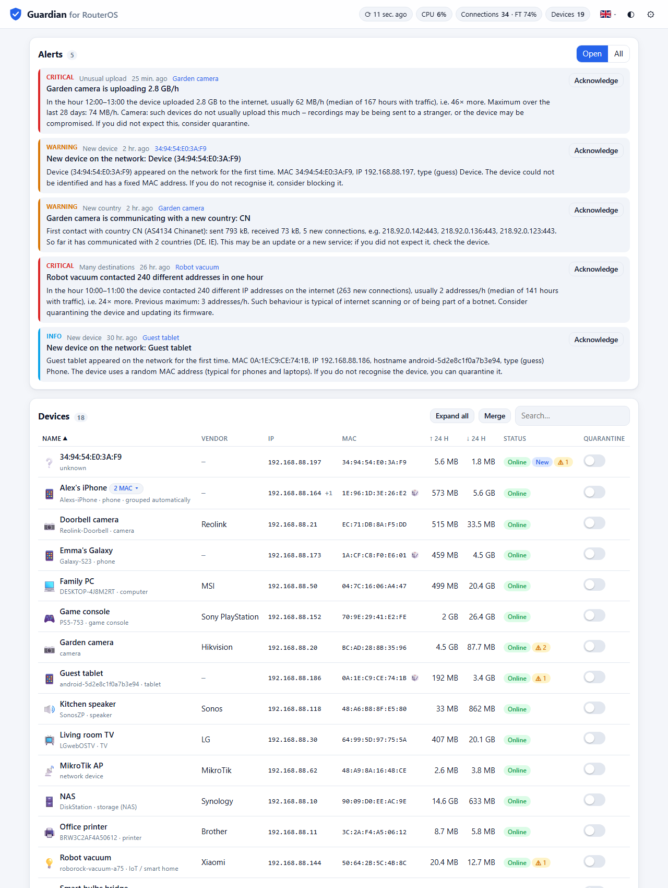
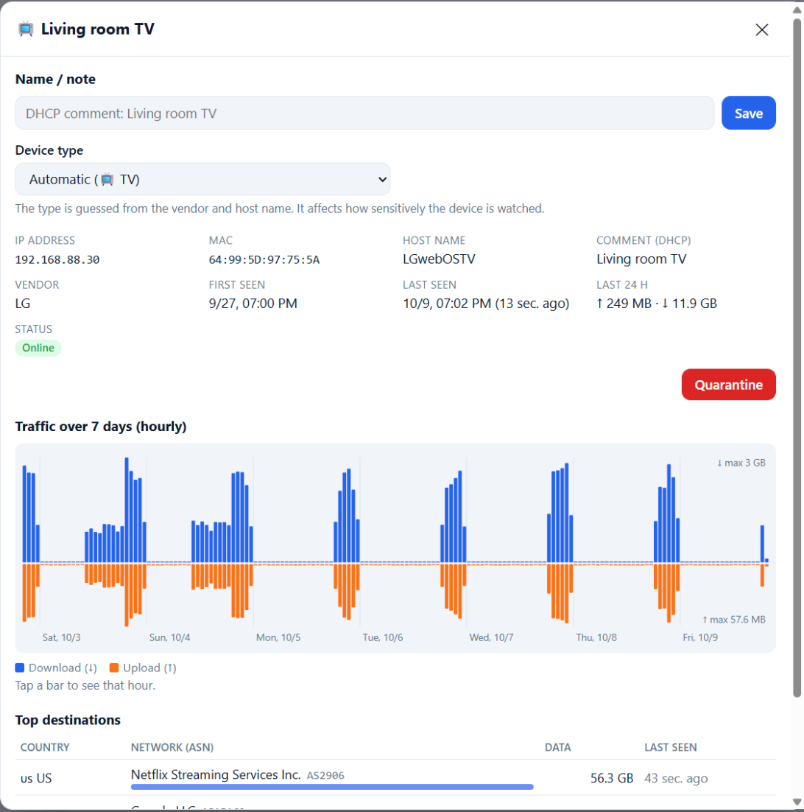
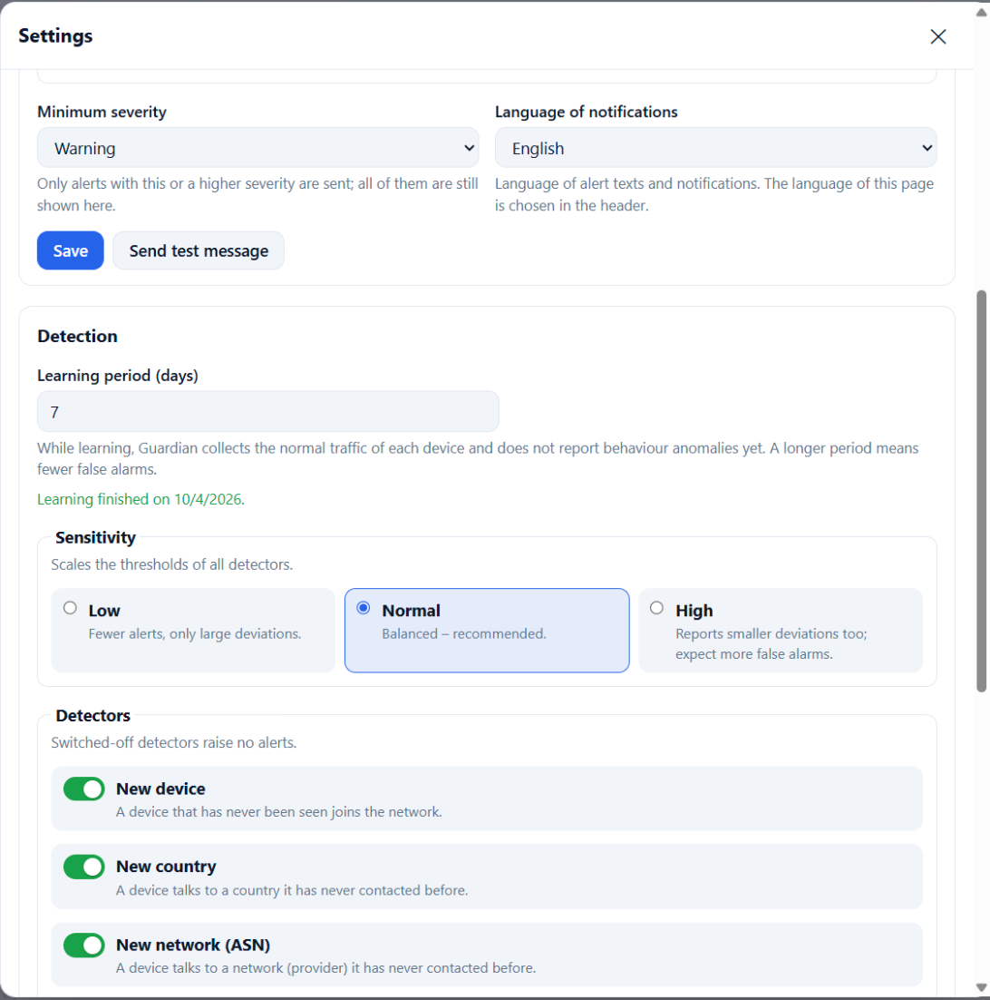
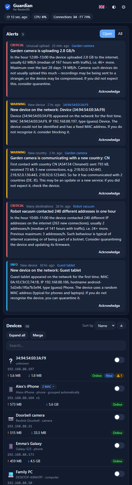

# Guardian for RouterOS

[](https://github.com/Marteva/routeros-guardian/actions/workflows/ci.yml)
[](https://github.com/Marteva/routeros-guardian/releases)
[](LICENSE)

[English](README.md) | **Čeština**

Guardian je malý hlídač anomálií pro domácí sítě, který běží jako
**kontejner přímo na routeru MikroTik** (RouterOS 7). Přes REST API routeru
čte DHCP leases, ARP tabulku a tabulku spojení (connection tracking), učí se,
co je u každého zařízení normální, a upozorní tě, když se něco změní: nové
zařízení v síti, kamera, která najednou komunikuje s novou zemí, chytrá
zásuvka, která odesílá stovky megabajtů, notebook, který skenuje internet.

Upozornění se zobrazují ve vestavěném webovém rozhraní a mohou chodit do
**Telegramu** nebo **ntfy**. Podezřelé zařízení můžeš jedním klikem dát do
**karantény** (firewall address-list na routeru mu odřízne internet).

Žádný cloud, žádný agent na zařízeních, žádný další hardware – jen router,
který už máš.

<picture>
  <source media="(prefers-color-scheme: dark)" srcset="docs/screenshots/overview-dark.png">
  
</picture>

| Detail zařízení | Nastavení | Telefon |
|---|---|---|
|  |  |  |

<sub>Snímky ukazují vestavěné demo s vymyšlenou domácností (`go run ./tools/demo`) – žádná skutečná data ze sítě. Rozhraní je v angličtině, česky se přepne v hlavičce.</sub>

> **Stav:** raná verze, ale v každodenním provozu. Testováno na hAP ax³
> (arm64) s RouterOS 7.24.4. Zpětná vazba a hlášení chyb jsou vítány.

## Obsah

- [Funkce](#funkce)
- [Jak funguje detekce](#jak-funguje-detekce)
- [Požadavky](#požadavky)
- [Rychlý start](#rychlý-start)
- [Vyzkoušení bez routeru](#vyzkoušení-bez-routeru)
- [Konfigurace](#konfigurace)
- [Notifikace](#notifikace)
- [Karanténa](#karanténa)
- [Bezpečnost](#bezpečnost)
- [Časté otázky a řešení problémů](#časté-otázky-a-řešení-problémů)
- [Sestavení ze zdrojových kódů](#sestavení-ze-zdrojových-kódů)
- [Roadmapa](#roadmapa)
- [Přispívání](#přispívání)
- [Licence a zdroje](#licence-a-zdroje)

## Funkce

- **Běží na routeru** – statická binárka v Go (~12 MB) v image o velikosti
  ~20 MB, < 50 MB RAM, úložiště SQLite, nepotřebuje žádné externí služby.
- **Inventář zařízení** – každé zařízení viděné přes DHCP/ARP s výrobcem
  (MAC OUI), odhadnutým typem, hostname, komentářem DHCP lease, prvním
  a posledním výskytem a provozem za posledních 24 h. Rozpozná náhodné
  (privátní) MAC adresy.
- **Baseline pro každé zařízení** – objem uploadu a počet cílů za hodinu dne,
  známé země a sítě (ASN) každého zařízení.
- **Pět detektorů** – nové zařízení, nová země, nové ASN, skok v uploadu,
  rozptyl cílů; laděné na přesnost, aby tě alerty neunavily.
- **Notifikace** – Telegram a/nebo ntfy, s minimální závažností,
  deduplikací a testovacím tlačítkem.
- **Karanténa jedním klikem** – přidá IP zařízení do firewall address-listu
  a ukončí jeho existující spojení.
- **Webové UI** – zařízení (seskupení, řazení, poznámky, ruční změna typu,
  ruční sloučení zařízení s rotující MAC), alerty, nastavení, světlý/tmavý
  motiv; 7 jazyků (angličtina, čeština, němčina, polština, ruština,
  španělština, portugalština).
- **Nastavení v UI** – notifikace, jazyk, délka učení, citlivost, detektory,
  retence – bez restartu kontejneru.
- **GeoIP** – země a ASN z bezplatných databází DB-IP Lite.
- **Healthcheck** – endpoint `/healthz` a `HEALTHCHECK` v image.
- **Volitelná záloha** – pravidelný snapshot databáze na připojený síťový disk.

## Jak funguje detekce

Každých 15 sekund Guardian přečte z routeru DHCP leases, ARP tabulku a IPv4
tabulku spojení. Pro každé spojení ze zařízení v LAN do internetu spočítá
přenesené bajty od předchozího dotazu a sčítá je po zařízeních a hodinách:
upload, download, počet různých cílových IP, cílové země a ASN.

**Doba učení.** Prvních **7 dní** (nastavitelné) se Guardian jen učí. Doba
učení začíná prvním viděným zařízením, takže restart kontejneru ji
nezačne znovu. Prvních 24 hodin je úvodní inventura – zařízení nalezená
v ní se nehlásí jednotlivě (přijde jedno souhrnné upozornění). Potom se
nová zařízení hlásí okamžitě; alerty na chování začnou po skončení doby
učení. Zařízení, které přibude později, má vlastní zahřívací dobu (3 dny
a alespoň 48 hodin s provozem), než se na něj alerty na chování uplatní.
Smazání naučených dat v UI spustí učení znovu.

**Baseline pro každé zařízení.** Hodinové hodnoty se porovnávají se stejnou
hodinou dne za posledních 28 dní (medián a medián absolutních odchylek; při
krátké historii všechny hodiny). Alert vyžaduje **zároveň** relativní
odchylku (poměr a robustní z-skóre) **a** absolutní minimum a hodnota musí
o 30 % překročit maximum zařízení v okně baseline – zařízení, které minulou
neděli zálohovalo 3 GB, není podezřelé, když to udělá znovu.

**Detektory**

| Alert | Kdy se spustí | Závažnost |
|---|---|---|
| `new_device` | objeví se nová MAC adresa (po úvodní inventuře) | info; warning u neklasifikovaného zařízení s pevnou MAC |
| `new_country` | zařízení si vymění podstatný objem dat se zemí, se kterou nikdy nekomunikovalo | warning; critical, když kamera/IoT odešle do té země ≥ 10 MB |
| `new_asn` | zařízení s malou stálou sadou cílů komunikuje s novou sítí (ASN) | warning |
| `upload_spike` | hodinový upload daleko nad baseline zařízení (rychlá cesta pro ≥ 1 GB během hodiny) | warning; critical u kamer/IoT |
| `dest_fanout` | neobvykle mnoho různých cílových IP za hodinu (skenování, botnet) | warning; critical u kamer/IoT |

**Citlivost.** Prahy závisí na typu zařízení: kamery a IoT se hlídají
přísně (čeká se málo cílů a skoro žádný upload), televize a neznámá
zařízení středně, telefony, tablety a počítače benevolentně (u nich se pro
nové země počítá jen upload, země musí být nová pro celou domácnost
a zařízení, která už komunikují s mnoha zeměmi, jsou vyjmuta). DNS, NTP
a ICMP se ignorují. Pokud je typ odhadnut špatně, změň ho v UI. Navíc
globální **citlivost** (nízká / normální / vysoká) škáluje všechny prahy
a každý detektor lze vypnout. Opakované alerty se deduplikují (výchozí
6 hodin).

Zdůvodnění návrhu a všechny prahy jsou popsané v
[`internal/detect/DESIGN.md`](internal/detect/DESIGN.md) (anglicky).

## Požadavky

| | |
|---|---|
| RouterOS | **7.20 nebo novější** s balíčkem `container` a device-mode `container=yes`. Testováno na 7.24.4. |
| Architektura | **arm64**, **arm** (32bitový ARMv7) nebo **x86_64** (např. hAP ax³, RB5009, CCR, CHR). |
| Úložiště | doporučen USB/SATA/NVMe disk (image ~20 MB, tarball dalších ~20 MB, databáze desítky MB). Kontejner nedávej na malou interní flash. |
| RAM | ~50 MB volné. |
| Volitelně | Telegram bot nebo aplikace ntfy pro push notifikace; GeoIP soubory DB-IP Lite pro alerty na zemi/ASN. |

## Rychlý start

Kompletní návod krok za krokem s vysvětlením, oběma síťovými variantami
a odinstalací je v **[docs/routeros-setup.md](docs/routeros-setup.md)**
(anglicky). Případně uprav parametry na začátku
[`deploy/routeros-setup.rsc`](deploy/routeros-setup.rsc) a soubor importuj.

Příkazy níže předpokládají výchozí nastavení RouterOS: router `192.168.88.1`,
LAN `192.168.88.0/24` na bridgi `bridge`, disk `usb1` a `192.168.88.250` jako
volnou adresu pro kontejner.

**1. Povol kontejnery** (jednou): `/system device-mode update container=yes`,
do 5 minut potvrď krátkým stiskem tlačítka reset nebo vypnutím a zapnutím
napájení, nainstaluj balíček `container` pro svou verzi RouterOS a restartuj.
Podrobnosti: [docs/routeros-setup.md](docs/routeros-setup.md#2-enable-containers).

**2. API uživatel, REST API, síť, pravidla karantény**

```routeros
/user group add name=guardian policy="read,write,api,rest-api,!local,!telnet,!ssh,!ftp,!reboot,!policy,!test,!winbox,!password,!web,!sniff,!sensitive,!romon"
/user add name=guardian group=guardian address=192.168.88.250/32 password="DLOUHE-NAHODNE-HESLO"
/ip service set www disabled=no

/interface veth add name=veth-guardian address=192.168.88.250/24 gateway=192.168.88.1 dhcp=no
/interface bridge port add bridge=bridge interface=veth-guardian
/interface list member add interface=veth-guardian list=LAN

/ip firewall filter add chain=forward action=drop src-address-list=guardian-quarantine comment="guardian: quarantine (src)" place-before=[find where comment="defconf: fasttrack"]
/ip firewall filter add chain=forward action=drop dst-address-list=guardian-quarantine comment="guardian: quarantine (dst)" place-before=[find where comment="defconf: fasttrack"]
```

**3. Proměnné prostředí a připojení dat**

```routeros
/container envs add list=guardian key=GUARDIAN_ROS_URL value="http://192.168.88.1"
/container envs add list=guardian key=GUARDIAN_ROS_PASS value="DLOUHE-NAHODNE-HESLO"
/container envs add list=guardian key=GUARDIAN_LAN value="192.168.88.0/24"
/container envs add list=guardian key=GUARDIAN_WEB_USER value="admin"
/container envs add list=guardian key=GUARDIAN_WEB_PASS value="HESLO-DO-UI"
/container envs add list=guardian key=GUARDIAN_LANGUAGE value="cs"
/container envs add list=guardian key=TZ value="Europe/Prague"
/container mounts add list=guardian-data src=/usb1/guardian/data dst=/data
```

**4. Vytvoř kontejner** – vyber jednu možnost:

*A) Stažení z GitHub Container Registry* (zatím neověřeno na routeru – pokud
selže, použij B):

```routeros
/container config set registry-url=https://ghcr.io tmpdir=/usb1/guardian/tmp
/container add name=guardian remote-image=marteva/routeros-guardian:latest interface=veth-guardian root-dir=/usb1/guardian/root envlists=guardian mountlists=guardian-data start-on-boot=yes logging=yes workdir=/
```

*B) Nahrání tarballu z release* (ověřeno): stáhni
`routeros-guardian-arm64.tar` (nebo `-arm` / `-amd64`) z
[posledního release](https://github.com/Marteva/routeros-guardian/releases/latest),
nahraj ho na `usb1` (Winbox → Files, nebo `scp`) a pak:

```routeros
/container add name=guardian file=/usb1/routeros-guardian-arm64.tar interface=veth-guardian root-dir=/usb1/guardian/root envlists=guardian mountlists=guardian-data start-on-boot=yes logging=yes workdir=/
```

**5. Spusť ho**, jakmile `/container print` ukazuje stav stopped (rozbalení
chvíli trvá):

```routeros
/container start [find where name=guardian]
/log print where topics~"container"
```

**6. Otevři UI** na `http://192.168.88.250:8080`, v **Nastavení** nastav
notifikace a doplň [GeoIP databáze](docs/routeros-setup.md#10-geoip-databases)
pro alerty na zemi/ASN. Pak ho nech týden učit.

## Vyzkoušení bez routeru

Chceš Guardian vidět ještě před instalací? [`tools/demo`](tools/demo) naplní
databázi **smyšlenou domácností** (18 zařízení, týden provozu a několik
alertů, které vyvolal skutečný detekční engine) a spustí pro ni falešné
RouterOS REST API. Guardian pak běží na tvém PC - bez routeru, bez Dockeru:

```sh
go run ./tools/demo -reset     # terminál 1: naplní demo.db, falešný router na 127.0.0.1:18728
```

Nástroj vypíše přesný příkaz pro druhý terminál (pro PowerShell i bash),
v zásadě:

```sh
GUARDIAN_ROS_URL=http://127.0.0.1:18728 GUARDIAN_ROS_PASS=demo GUARDIAN_DB=demo.db \
GUARDIAN_LAN=192.168.88.0/24 GUARDIAN_LISTEN=127.0.0.1:8080 go run ./cmd/guardian
```

Pak otevři `http://127.0.0.1:8080`. Příběh: zahradní kamera začala
komunikovat s novou zemí a za poslední hodinu odeslala 2,8 GB, robotický
vysavač v noci kontaktoval 240 adres na internetu, před dvěma hodinami se
připojilo neidentifikované zařízení ESP a včera tablet hosta. Provoz dál
běží a karanténa funguje i proti falešnému routeru. Všechna jména, adresy
a MAC adresy jsou smyšlené; texty alertů v demu jsou anglicky. Bez `-reset`
se existující demo databáze použije znovu; `-reset` ji naplní znovu vzhledem
k aktuálnímu času (nejdřív zastav Guardian; databázi, kterou nástroj
nevytvořil, odmítne smazat).
Když jsou [GeoIP soubory](docs/routeros-setup.md#10-geoip-databases)
v `dist/geo`, vypsaný příkaz je obsahuje, takže i živý provoz dostane země
a ASN.

## Konfigurace

Guardian při startu čte proměnné prostředí (nastavují se přes
`/container envs`). Nejdůležitější:

| Proměnná | Výchozí | Popis |
|---|---|---|
| `GUARDIAN_ROS_URL` | `http://172.17.0.1` | základní URL REST API RouterOS, např. `http://192.168.88.1` |
| `GUARDIAN_ROS_USER` | `guardian` | API uživatel |
| `GUARDIAN_ROS_PASS` | – (**povinné**) | heslo API uživatele |
| `GUARDIAN_ROS_INSECURE_TLS` | `true` | akceptovat self-signed certifikát `www-ssl` |
| `GUARDIAN_POLL_INTERVAL` | `15s` | interval čtení routeru (min. `5s`) |
| `GUARDIAN_LAN` | `192.168.88.0/24` | LAN prefixy oddělené čárkou |
| `GUARDIAN_DB` | `/data/guardian.db` | databáze SQLite |
| `GUARDIAN_GEOIP_COUNTRY` / `GUARDIAN_GEOIP_ASN` | `/data/geo/country.mmdb` / `/data/geo/asn.mmdb` | databáze DB-IP Lite (volitelné) |
| `GUARDIAN_LISTEN` | `:8080` | adresa webového UI |
| `GUARDIAN_WEB_USER` / `GUARDIAN_WEB_PASS` | – | přihlášení do UI (HTTP Basic); prázdné = bez přihlášení |
| `GUARDIAN_QUARANTINE_LIST` | `guardian-quarantine` | firewall address-list pro karanténu |
| `GUARDIAN_BACKUP` / `GUARDIAN_BACKUP_INTERVAL` | – / `1h` | volitelná cesta a interval snapshotu databáze |
| `GUARDIAN_LEARN_PERIOD` * | `7d` | délka učení |
| `GUARDIAN_RETENTION` * | `60d` | jak dlouho se drží statistiky |
| `GUARDIAN_DEDUP_WINDOW` * | `6h` | stejný alert se v tomto okně pošle jen jednou |
| `GUARDIAN_LANGUAGE` * | – (angličtina) | jazyk notifikací: en, cs, de, pl, ru, es, pt (prázdné = angličtina; UI včetně alertů má vlastní přepínač jazyka) |
| `GUARDIAN_TELEGRAM_TOKEN` / `GUARDIAN_TELEGRAM_CHAT` * | – | token Telegram bota a chat ID |
| `GUARDIAN_NTFY_URL` / `GUARDIAN_NTFY_TOKEN` * | – | URL ntfy tématu a volitelný token |
| `TZ` | UTC | časová zóna, např. `Europe/Prague` |

\* Lze měnit i ve webovém UI (**Nastavení**). Proměnná prostředí je výchozí
hodnota; jakmile hodnotu uložíš v UI, platí uložená hodnota (pozdější změny
proměnné se ignorují). Minimální závažnost notifikací, citlivost a zapnuté
detektory se nastavují jen v UI. Doby přijímají `15s`, `168h` nebo `7d`.

Kompletní přehled: **[docs/configuration.md](docs/configuration.md)** (anglicky).

## Notifikace

Nastav je v UI (**Nastavení**, pak **Odeslat testovací notifikaci**) nebo
proměnnými prostředí. Tokeny zadané v UI nejsou vidět v `/container envs`,
které může číst každý uživatel routeru s právem `read`. Ve výchozím stavu se
posílají jen alerty se závažností *warning* a vyšší; pro upozornění na každé
nové zařízení nastav minimum na *info*.

### Telegram

1. V Telegramu otevři **@BotFather**, pošli `/newbot` a postupuj podle
   pokynů. Získáš token bota ve tvaru `123456789:AA...`.
2. Pošli svému novému botovi libovolnou zprávu (nebo ho přidej do skupiny
   a napiš tam).
3. Otevři v prohlížeči `https://api.telegram.org/bot<TOKEN>/getUpdates`
   a najdi `"chat":{"id":...}`. ID skupinových chatů jsou záporná čísla.
4. Zadej token a chat ID v **Nastavení** (nebo nastav
   `GUARDIAN_TELEGRAM_TOKEN` a `GUARDIAN_TELEGRAM_CHAT`).

### ntfy

1. Nainstaluj aplikaci **ntfy** (Android/iOS) – <https://ntfy.sh>.
2. Vymysli **dlouhý náhodný název tématu** – kdo ho zná, čte tvoje alerty,
   např. `guardian-k7f3q9x2m1v8`.
3. V aplikaci se k tématu přihlas (*Subscribe to topic*).
4. Zadej `https://ntfy.sh/guardian-k7f3q9x2m1v8` jako ntfy URL v **Nastavení**
   (nebo `GUARDIAN_NTFY_URL`). Pro chráněné téma nebo vlastní server přidej
   access token (`GUARDIAN_NTFY_TOKEN`).

Kritické alerty se posílají s vysokou prioritou.

## Karanténa

Tlačítko **Karanténa** u zařízení:

1. přidá aktuální IPv4 adresu zařízení do address-listu
   `guardian-quarantine` na routeru,
2. odstraní existující záznamy zařízení z tabulky spojení (aby už navázaná,
   fasttrackovaná spojení nemohla pokračovat).

Co se s provozem stane, rozhodují **tvoje pravidla firewallu** (krok 2
rychlého startu). Obě drop pravidla v chainu forward **musí být před
pravidlem fasttrack** – fasttrackované pakety firewall obcházejí a při
volném sledování TCP (loose tracking) se i paket ze středu starého spojení
znovu zachytí jako *established*.

| Blokováno | Funguje dál |
|---|---|
| přístup do internetu oběma směry | provoz se zařízeními ve stejném bridgi (L2 – tiskárna, casting, …) |
| přístup do jiných routovaných podsítí/VLAN | DHCP a DNS na routeru (pokud nepřidáš volitelná input pravidla) |
| | IPv6 (karanténa je jen pro IPv4) |

Záznam je podle IP adresy – když zařízení dostane jinou adresu, karanténa
na něj přestane platit (pomůže statický DHCP lease). **Uvolnění** záznam
zase odebere. Pro úplnou izolaci použij samostatnou VLAN nebo hostovskou
Wi-Fi. Podrobnosti: [docs/routeros-setup.md](docs/routeros-setup.md#7-quarantine-firewall-rules).

## Bezpečnost

- **API uživatel s minimálními právy.** Skupina `guardian` má jen `read`,
  `write`, `api` a `rest-api`. `write` je nutné kvůli address-listu karantény
  a mazání spojení, obecně ale dovoluje měnit konfiguraci – použij dlouhé
  náhodné heslo a omez `address=` uživatele na IP kontejneru.
- **REST API jen v LAN.** Nikdy nevystavuj `www`/`www-ssl` do internetu.
  Když je kontejner v LAN bridgi, jeho provoz k API neopustí router;
  podporováno je i `www-ssl` (HTTPS).
- **Chraň UI.** Nastav `GUARDIAN_WEB_USER` / `GUARDIAN_WEB_PASS`. UI nech
  dostupné jen z LAN – žádné přesměrování portů; pro vzdálený přístup použij
  VPN (např. WireGuard na routeru). Měnící API požadavky vyžadují vlastní
  hlavičku a požadavky ze stejného originu (ochrana proti CSRF). `/healthz`
  je jediný endpoint bez přihlášení a prozrazuje jen ok/není ok.
- **Tajné údaje.** Hodnoty v `/container envs` vidí každý uživatel routeru
  s právem `read`. Tokeny notifikací raději zadej v UI; ukládají se do
  databáze Guardianu a nikdy se neposílají zpět do prohlížeče. Podle toho
  chraň i disk (a zálohy).
- **Izolace kontejneru.** Image obsahuje statickou binárku na distroless
  základu bez shellu. Uvnitř kontejneru běží jako root, protože mounty na
  USB discích v RouterOS obvykle vlastní root (ne-rootové sestavení je
  možné, viz [Dockerfile](Dockerfile)).

Našel jsi zranitelnost? Nahlas ji prosím neveřejně – viz [SECURITY.md](SECURITY.md).

## Časté otázky a řešení problémů

**Funguje to se zapnutým FastTrackem?**
Ano. Fasttrackovaná spojení obcházejí firewall, ale čítače bajtů v tabulce
spojení se dál aktualizují (ověřeno na hAP ax³ s ~95 % spojení ve
fasttracku), takže statistiky provozu zůstávají přesné. Při hardwarovém
offloadu (`hw-offload=yes` na switch čipech s podporou L3 HW offloadu) se
čítače offloadovaných spojení aktualizovat nemusí – ověř to probem (níže).

**V logu je `401` / `poll failed ... 401 Unauthorized`.**
Špatné heslo, `address=` uživatele neobsahuje IP kontejneru, nebo skupina
nemá právo `rest-api`. Zkontroluj `/user print detail` a
`/log print where message~"login failure"`. `connection refused` nebo timeout
znamená, že služba `www`/`www-ssl` je vypnutá, běží na jiném portu než
v `GUARDIAN_ROS_URL`, nebo její `address=` kontejner nepovoluje.

**Co dělá healthcheck?**
`/healthz` vrací `200 ok`, dokud se čtení routeru daří, a `503` s krátkým
důvodem, když je poslední úspěšné čtení příliš staré. Image spouští
`/guardian -healthcheck` jako svůj `HEALTHCHECK`; zda RouterOS healthchecky
z image vyhodnocuje, není ověřeno – `http://<ip-kontejneru>:8080/healthz`
můžeš hlídat sám (např. přes `/tool netwatch`).

**Kontejner hned po startu skončí.**
Viz `/log print where topics~"container"`. `GUARDIAN_ROS_PASS is required`
znamená, že seznam proměnných není připojen (`envlists=`) nebo proměnná chybí.

**`/container add` nedokáže image importovat.**
Tarball musí odpovídat architektuře routeru (`/system resource print`), musí
být celý nahraný a cesta v `file=` musí být správná. Zkontroluj
`/log print where topics~"container"`.

**`not allowed by device-mode`.**
Změna device-mode nebyla do 5 minut fyzicky potvrzena – zopakuj ji.

**Nechodí alerty na zemi/ASN.**
Buď chybí GeoIP soubory v `/data/geo/` (log hlásí `geoip disabled`), nebo
ještě běží doba učení.

**Notifikace selhávají s `x509: certificate signed by unknown authority`.**
Image byl sestaven bez CA certifikátů (`--no-ca-cert`). Použij image z release
nebo sestav image s CA bundlem.

**Notifikace končí timeoutem.**
Kontejner nemá přístup do internetu nebo DNS: zkontroluj výchozí bránu veth,
masquerade pravidlo a DNS na routeru.

**Flash routeru je plná.**
`root-dir`, `tmpdir` nebo tarball skončily na interní flash místo na disku.

**Test proveditelnosti (probe).** `cmd/probe` se na několik hodin připojí
k REST API a vyhodnotí velikost tabulky spojení, podíl fasttracku, zda se
u fasttrackovaných spojení hýbou čítače bajtů, pokrytí provozu, latenci
dotazů a zátěž CPU routeru – hodí se před instalací na vytíženou síť:

```sh
go run ./cmd/probe -url http://192.168.88.1 -user guardian -pass HESLO -duration 4h
```

(`address=` uživatele musí dočasně zahrnovat tvůj PC.) Binárka je i v image
jako `/probe`.

## Sestavení ze zdrojových kódů

Potřebuješ Go (verze podle [`go.mod`](go.mod)), bez CGO, Docker není nutný.

```sh
go test ./...
scripts/build.sh --arch arm64 --version 0.3.1      # Linux/macOS
.\scripts\build.ps1 -Arch arm64 -Version 0.3.1     # Windows
```

Oba skripty cross-kompilují `guardian` a `probe` a složí
`dist/routeros-guardian-<arch>.tar` (tarball ve formátu `docker save`
s jednou nekomprimovanou vrstvou, vytvořený nástrojem
[`tools/mkimage`](tools/mkimage)), který RouterOS importuje přes
`/container add file=...`. S Dockerem:

```sh
docker buildx build --platform linux/arm64 -o type=docker,dest=routeros-guardian-arm64.tar -t routeros-guardian:latest .
```

Dokumentace pro vývojáře: [ARCHITECTURE.md](ARCHITECTURE.md),
[CONTRIBUTING.md](CONTRIBUTING.md) (anglicky).

## Roadmapa

- **Integrace DNS** s Pi-hole / AdGuard Home – v alertech doménová jména
  místo holých IP.
- **Detektor posunu chování** – pomalé dlouhodobé změny profilu zařízení
  (srovnání týden po týdnu).
- **Týdenní souhrn** v notifikaci.
- **IPv6** – sledování i karanténa.

Nápady a pull requesty jsou vítány – u větších změn prosím nejdřív založ issue.

## Přispívání

Viz [CONTRIBUTING.md](CONTRIBUTING.md) – vývojové prostředí, testy, styl kódu
a jak přidat nebo vylepšit překlady.

## Licence a zdroje

- Guardian for RouterOS je vydán pod [licencí MIT](LICENSE).
- IP Geolocation by [DB-IP](https://db-ip.com), licence
  [Creative Commons Attribution 4.0 International (CC BY 4.0)](https://creativecommons.org/licenses/by/4.0/).
  Databáze nejsou součástí repozitáře ani image; stahují je skripty
  `scripts/update-geoip.*`.
- Prefixy výrobců MAC: ručně vybraná podmnožina registru IEEE OUI.

*Projekt není nijak spojen se společností MikroTik ani jí podporován.
MikroTik a RouterOS jsou ochranné známky společnosti SIA Mikrotīkls.*
